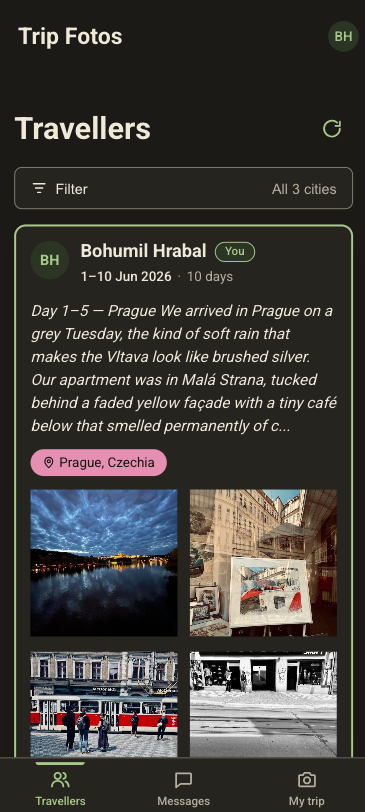

# trip-fotos-react

[](https://github.com/andres-codigo/trip-fotos-react/actions/workflows/cypress-component.yml)
[](https://github.com/andres-codigo/trip-fotos-react/actions/workflows/cypress-e2e.yml)
[](https://github.com/andres-codigo/trip-fotos-react/actions/workflows/vitest-unit-tests.yml)

## Contents

- [📘 About This Project](#about-this-project)
- [✨ Features](#features)
- [🚧 Status](#status)
- [🧱 Stack](#stack)
- [⚡ Quick Start](#quick-start)
- [🎯 Scripts](#scripts)
- [⚙️ Setup](#setup)
- [🤖 AI Assistance](#ai-assistance)
- [🧪 Testing and CI](#testing-and-ci)
- [📦 Build and Deployment](#build-and-deployment)
- [📁 Folder Structure](#folder-structure)
- [🧯 Troubleshooting](#troubleshooting)

<a id="about-this-project"></a>

## 📘 About This Project

Trip Fotos is a place to share and find popular travel destinations: travellers register a trip with its dates, cities and photos, browse each other's trips and message one another. It began as a UI and functional conversion of the "Find a coach" project from the Udemy course _Vue - The Complete Guide (incl. Router & Composition API)_, and has since been rebuilt and extended well beyond it.

**Live:** [trip-fotos-project-react.vercel.app](https://trip-fotos-project-react.vercel.app)

<p>
  
  
</p>

Worth highlighting:

- **Rules as the security boundary** — the Firebase database and Storage rules, versioned in the repo, enforce ownership, the admin role, verified email and the public trip summary on the server, whatever the app sends.
- **Tested at three layers** — Vitest, Cypress component tests and Cypress E2E specs against the local Firebase emulators, run in CI on every pull request.
- **AI-assisted development** — GitHub Copilot and Claude Code share one set of repository instructions, with hooks, skills and CI enforcing the quality gates. The Vue port was largely delivered by an agent pipeline under human review: see the [AI-Assisted Development Story](docs/ai-assisted-dev-story/README.md).

<a id="features"></a>

## ✨ Features

- **Authentication and account** — email/password sign-up and log-in with Firebase Authentication, email verification and a session that lasts until you log out. Account settings shows whether your email is verified and changes the email or password.
- **Verified email to post** — an unverified account can browse, but the database and Storage rules refuse a trip, photos or a message until its email is verified.
- **Trip registration** — one form for the trip dates, description, cities (a type-ahead search with [Photon](https://photon.komoot.io), OpenStreetMap data) and photos, added by drag-and-drop or file picker with previews and optional alt text, then compressed and uploaded to Cloud Storage with a progress bar.
- **Public preview** — logged-out visitors browse a summary of every trip; the full trip, every photo and messaging need sign-in.
- **Travellers** — a card grid with a city filter and paging, and a details page per traveller with a full-screen, swipeable photo viewer.
- **Editing your trip** — change any part of your trip, add or remove photos with Undo, or delete your profile.
- **Messaging** — travellers message each other in conversation threads, like a phone text thread, with unread counts and delete with Undo; no email is shared.
- **Navigation** — header links on desktop and a bottom tab bar on phones, with Log out in an account menu.
- **Admin tools** — an admin role, set as a Firebase custom claim and enforced by the rules, can remove a traveller and their data.
- **Privacy and accessibility** — a public privacy policy; skip link, landmarks and per-page titles, following [The Website Specification](https://specification.website).
- **Deployment and security** — Vercel with a route allow-list, real 404s, an enforced Content Security Policy and other security headers.

<a id="status"></a>

## 🚧 Status

Feature parity with the original Vue app is complete (epic [#274](https://github.com/andres-codigo/trip-fotos-react/issues/274)), and the app is live. Current work is polish, consistency and tooling rather than new features.

**Recently shipped**

- Phone polish: clearer menu hover, larger page titles closer to the header, a quieter See all photos tile, photos that load into place and tidier date fields
- Photo viewer: swipe down to close, and arrows that line up with the title and close button on phones
- Account settings: see your email's verified state, change your email or password
- Verified email to post: browse at once, post once your email is verified
- Stay signed in until you log out, including in the home-screen app
- Clearer form errors: each error sits under its field's label
- Developer tooling: issue-to-PR automation, faster scoped CI and local checks, an unused-code check, a leaner repo and test suite, a dev container that works outside VS Code, and AI guidance with a drift check

**Blocked**

- [#770](https://github.com/andres-codigo/trip-fotos-react/issues/770) — en-GB sender name and copy for Firebase emails, blocked while an `%APP_NAME%` issue is resolved with Firebase Support
- [#321](https://github.com/andres-codigo/trip-fotos-react/issues/321) — ESLint 10, waiting on `eslint-plugin-react` support

<a id="stack"></a>

## 🧱 Stack

This project uses the following technologies:

- [Vite](https://vite.dev/) for development and build.
- [React](https://react.dev/) as the front-end library.
- [React Router](https://reactrouter.com/) for routing.
- [Redux Toolkit](https://redux-toolkit.js.org/) for state management, with [Redux Persist](https://github.com/rt2zz/redux-persist) keeping the travellers list between visits; the Firebase Auth SDK keeps the session itself.
- [Tailwind CSS](https://tailwindcss.com/) v4 for all styling: semantic design tokens and utility classes (theme and utilities only, no preflight) in `src/styles/tailwind.css`, with `class-variance-authority` for component variants. There are no SCSS or CSS modules.
- [shadcn/ui](https://ui.shadcn.com/) configured through `components.json` (JavaScript, `@/` aliases); components are added with `npx shadcn@latest add` and moved into the folder-per-component layout.
- [ESLint](https://eslint.org/) for JavaScript linting.
- [knip](https://knip.dev/) for finding unused files, exports and dependencies.
- [Prettier](https://prettier.io/) for code formatting, with `prettier-plugin-tailwindcss` sorting the utility classes.
- [Vitest](https://vitest.dev/) for unit and integration testing.
- [Cypress](https://www.cypress.io/) for end-to-end and component testing.
- [Firebase Realtime Database](https://firebase.google.com/docs/database) for storing travellers and messages.
- [Firebase Authentication](https://firebase.google.com/docs/auth) for managing sign-in credentials.
- [Firebase Cloud Storage](https://firebase.google.com/docs/storage) for storing uploaded traveller images.
- [Photon](https://photon.komoot.io) (OpenStreetMap data) for the city search.
- [Vercel](https://vercel.com/) for hosting, with cookieless Web Analytics and Speed Insights.

<a id="quick-start"></a>

## ⚡ Quick Start

Requires [Node.js](https://nodejs.org/) 24 or later (see `.nvmrc`) and npm.

```bash
git clone https://github.com/andres-codigo/trip-fotos-react
cd trip-fotos-react
npm install       # also installs Cypress and Vitest
npm run dev       # http://localhost:3000
```

The app needs a Firebase project and a `.env` file first — see [Setup](#setup).

A [VS Code Dev Container](.devcontainer/devcontainer.json) is included. It bind-mounts `~/.gitconfig`, `~/.config/gh` and `~/.claude` from the host, so set those up first; if they are missing, Docker creates empty placeholders and the matching tool is unauthenticated inside the container. Claude Code keeps its config in `~/.claude/.claude.json` (via `CLAUDE_CONFIG_DIR`) rather than a bind-mounted `~/.claude.json`, because a single-file mount breaks when Claude Code replaces the file on save. The dev server and emulator ports are published with `appPort`, so `https://localhost:3000` also works from a terminal outside VS Code (`devcontainer exec --workspace-folder . bash`), and git authenticates through `gh` (`gh auth setup-git` runs on create) rather than VS Code's credential helper, so pushes work there too; rebuild the container after pulling this change.

<a id="scripts"></a>

## 🎯 Scripts

Below are the available npm scripts for this project:

```bash
# Start the development server
npm run dev

# Build the project for production
npm run build

# Preview the production build locally
npm run build:preview

# Visual Vite bundle analysis
npm run analyse

# Run ESLint to check for issues
npm run lint

# Find unused files, exports and dependencies (knip)
npm run knip

# Format files with Prettier
npm run format

# Automatically fix linting issues and format files
npm run lint:fix

# Run all tests once with the dot reporter (no coverage)
npm run vitest:run

# Run Vitest in watch mode
npm run vitest:watch

# Run tests with coverage reporting enabled
npm run vitest:coverage

# Open the Cypress E2E Test Runner in interactive mode
npm run cy:open:e2e

# Open the Cypress Component Test Runner in interactive mode
npm run cy:open:ct

# Run the E2E specs against the local Firebase emulators (no live project or secrets)
npm run cy:run:e2e:emulators

# Run the read-only live smoke spec against the real Firebase project (needs the CYPRESS_USER_* credentials in .env)
npm run cy:run:e2e:live

# Run Cypress Component tests in headless mode
npm run cy:run:ct

# Smart test runner - automatically detects component vs E2E tests
npm run cy:run:auto [file-path]

# Deploy Realtime Database and Storage security rules
npm run firebase:rules

# Start the Firebase emulators (Auth, Realtime Database, Storage) with the real rules
npm run emulators

# Reset the running emulators to the deterministic seed data (refuses to run without the emulator host variables)
npm run emulators:seed

# Grant or remove the admin custom claim (see Setup > Admin Role)
npm run admin:claim -- <email> [--remove]

# Rebuild the public trip summaries from the traveller records (see Setup > Public trips)
npm run public-trips:backfill [-- --write]

# Move messages into conversation threads (see Setup > Message threads)
npm run messages:migrate [-- --write]

# Mark accounts made before email verification as verified (see Setup > Verified email)
npm run accounts:mark-verified [-- --write]
```

<a id="setup"></a>

## ⚙️ Setup

### Firebase Configuration

#### Prerequisites

- A [Google Account](https://accounts.google.com/) is required.
- A [Blaze Plan](https://firebase.google.com/pricing?hl=en) is necessary for database and storage capabilities.

#### Steps

1. **Create a Firebase Project**
   Sign in to your [Firebase Console](https://console.firebase.google.com) and create a new project.

2. **Enable Required Firebase Products**
   Navigate to the "Build" dropdown menu in your Firebase project and enable the following:
    - **Realtime Database**
        - Set the location to **United States (us-central1, us-east1, or us-west1)**.
        - Copy the database URL and add it to your `.env` file under `VITE_BACKEND_BASE_URL`.
        - Rules live in [`database.rules.json`](firebase/database.rules.json) and are deployed with `npm run firebase:rules` (see [Firebase Security Rules](#firebase-security-rules)).
          Travellers can only change their own record. Only the two members can read a conversation; a message is accepted only from a signed-in traveller writing as themselves (`senderId`) with the server's time, together with both members' summaries in the same update, and is never edited. Each traveller alone sets their own `readAt` and `clearedAt`. The older `/messages` inboxes can only be read or deleted until the migration removes them.

    - **Authentication**
        - Go to "Sign-in Method" and enable **Email/Password**. Ensure **Email link (passwordless sign-in)** is NOT enabled.

    - **Cloud Storage**
        - Set up a [Blaze Plan](https://firebase.google.com/pricing?hl=en) to enable storage capabilities.
        - Rules live in [`firebase/storage.rules`](firebase/storage.rules): signed-in users write only to their own `images/{uid}/` folder (the app signs in through the Firebase Auth SDK, so uploads carry the user's ID token), and an admin (see [Admin Role](#admin-role)) can delete other travellers' photos.

3. **Add Firebase to Your Web App**
    - Register your app in the Firebase Console.
    - Copy the Firebase configuration values and add them to your `.env` file.

<a id="firebase-security-rules"></a>

#### Firebase Security Rules

`firebase.json` points the Firebase CLI at `firebase/database.rules.json` and `firebase/storage.rules`, so the rules are versioned with the code. Edit them there, never in the Console, then deploy to the project in `.firebaserc`:

```bash
npx firebase-tools login      # once
npm run firebase:rules        # firebase-tools deploy --only database,storage
```

Use the Console's Rules Playground to try a rule before deploying it.

<a id="firebase-emulators"></a>

#### Firebase Emulators

The Auth, Realtime Database and Storage emulators run locally against the same rules files, with no credentials (the `demo-trip-fotos` project never touches real resources). They need Java 21, which the dev container installs (rebuild it after pulling).

```bash
npm run emulators                 # Auth 9099, Database 9000, Storage 9199, UI http://127.0.0.1:4000
npm run dev -- --mode emulators   # in a second terminal: the app against them
```

`--mode emulators` loads [`.env.emulators`](.env.emulators), which sets `VITE_USE_FIREBASE_EMULATORS` (the dev server, or a build made with `--mode emulators` as the E2E runner does; a Vercel build ignores it) and `VITE_DATABASE_NAMESPACE`. The namespace is added to every Realtime Database request as `?ns=`, because the emulator serves a request without one from a namespace that has no rules. **Never set either variable in Vercel.**

`npm run emulators:seed` clears the emulators and loads a fixed data set: a standard user (not a traveller), two travellers (one with four photos and all eight badge tones, one with none), an admin (`admin: true` claim) and conversations for the first traveller (an unread two-sided thread with the second traveller, a read one from a former traveller, and an older email-only message). Run it through `firebase emulators:exec` so the host variables are set; it refuses to run without them, so it can never write to the live project. The accounts are listed in [`scripts/seed-emulators.mjs`](scripts/seed-emulators.mjs), and `cy.task('seedEmulators')` re-seeds from a spec.

<a id="admin-role"></a>

#### Admin Role

The admin role is a Firebase Auth custom claim (`admin: true`), so the database and Storage rules enforce it and no admin ID is bundled into the client.

1. In the Firebase Console, go to Project settings > Service accounts and generate a new private key. Save it **outside the repo** — `.gitignore` also ignores common key file names as a safety net.
2. Grant (or remove) the claim:

    ```bash
    GOOGLE_APPLICATION_CREDENTIALS=/path/to/key.json npm run admin:claim -- admin@example.com
    GOOGLE_APPLICATION_CREDENTIALS=/path/to/key.json npm run admin:claim -- admin@example.com --remove
    ```

3. The claim reaches the app when the ID token is next renewed (within an hour) or at the next sign-in: claims are read from the ID token and stored as `isAdmin` in the authentication slice (`selectIsAdmin`).

<a id="public-trips"></a>

#### Public trips

Logged-out visitors read `/publicTrips`, a summary of each trip (first name and last initial, the first 200 characters of the description, cities, trip dates and the first three photos); the full `/travellers` records need sign-in. The app writes both in one update, so they stay in step. To build the summaries for trips saved before they existed, or to rebuild them, run the backfill with the service-account key from Admin Role. It only counts until you add `--write`, and it runs before `npm run firebase:rules` deploys the rule that closes `/travellers`. When the summary's fields change, deploy the rules that accept the new shape first, then rerun the backfill, then deploy the app:

```bash
GOOGLE_APPLICATION_CREDENTIALS=/path/to/key.json npm run public-trips:backfill
GOOGLE_APPLICATION_CREDENTIALS=/path/to/key.json npm run public-trips:backfill -- --write
```

<a id="message-threads"></a>

#### Message threads

Messages live in conversations both travellers see (`/conversations`, with a per-traveller summary in `/userConversations`); messages stored before that sit in each recipient's `/messages` inbox. The migration moves each one from a traveller into its conversation and each email-only one to `/legacyMessages` (read-only), then removes `/messages`. It only counts until you add `--write`. Deploy the rules first, then run it, then deploy the app:

```bash
GOOGLE_APPLICATION_CREDENTIALS=/path/to/key.json npm run messages:migrate
GOOGLE_APPLICATION_CREDENTIALS=/path/to/key.json npm run messages:migrate -- --write
```

Rerunning it is safe: a traveller whose conversation entry already holds a newer message keeps it.

<a id="verified-email"></a>

#### Verified email

The rules let only an account with a verified email write a trip, upload photos or send a message. Accounts made before sign-up asked for verification (0.28.0) never got the email, so mark them verified once with the service-account key from Admin Role. It only lists them until you add `--write`. Run it, then deploy the rules with `npm run firebase:rules`:

```bash
GOOGLE_APPLICATION_CREDENTIALS=/path/to/key.json npm run accounts:mark-verified
GOOGLE_APPLICATION_CREDENTIALS=/path/to/key.json npm run accounts:mark-verified -- --write
```

### Environment Variables

Copy [`.env.example`](.env.example) to `.env` and fill in the values from your Firebase web app's `firebaseConfig`:

```bash
cp .env.example .env
```

| Variable                                      | Used for                                                                 |
| --------------------------------------------- | ------------------------------------------------------------------------ |
| `VITE_FIREBASE_*`, `VITE_DATABASE_URL`        | Firebase SDK (Auth, Realtime Database, Storage)                          |
| `VITE_BACKEND_BASE_URL`                       | Realtime Database REST calls                                             |
| `VITE_API_URL`, `VITE_API_KEY`                | Firebase Auth REST API — profile updates, and the E2E sign-in intercepts |
| `VITE_ROOT_URL`                               | Cypress `baseUrl`                                                        |
| `CYPRESS_USER_EMAIL`, `CYPRESS_USER_PASSWORD` | An existing test account the live smoke spec signs in with               |
| `VITE_OPEN` (optional)                        | `true` opens the browser when the dev server starts                      |

[`.env.emulators`](.env.emulators) is committed (no secrets) and holds the emulator values; see [Firebase Emulators](#firebase-emulators).

`.env` is gitignored — never commit it. When you add, rename or remove a variable, update `.env.example` and this table together.

### Firebase Project Configuration File

Create a `.firebaserc` file in the root directory with the following content:

```json
{
	"projects": {
		"default": "your-project-name"
	}
}
```

### HTTPS for Local Development

Optional: with a self-signed certificate in `certs/`, `npm run dev` serves over HTTPS; without one it falls back to HTTP, as in CI and on Vercel. See [docs/local-https.md](docs/local-https.md).

<a id="ai-assistance"></a>

## 🤖 AI Assistance

GitHub Copilot and Claude Code share one set of guidance, so the two tools do not drift apart:

- **Shared conventions** — `.github/copilot-instructions.md` and `CLAUDE.md` hold the workspace rules; `.github/instructions/*.instructions.md` hold the component, page, store, styling, testing and CI/scripts guidance both tools read (Claude Code loads each through a path-scoped rule in `.claude/rules/`).
- **Scaffolding agents** — `create-component`, `create-page`, `create-redux-slice` and `create-hook` live in `.github/agents/`, with thin Claude Code wrappers in `.claude/agents/`.
- **Enforced quality** — Claude Code hooks format and lint every edited file, block file changes without an issue branch and draft PR, block commits without a `/verify` pass, and stop a ready PR from ending a turn with a stale README Status; and the `/verify` skill runs only the lint, unused-code (knip), Vitest, Cypress component and build gates a change can affect, caching each gate's pass so a re-run skips gates no later edit can affect. `/verify e2e` adds the emulator E2E suite. A change to a page's look goes build, targeted tests, `/ui-check` and its fixes, then `/verify` once: `/verify` refuses a UI change until `/ui-check` has passed on it.
- **Workflow skills** — `/start-issue` and `/finish-pr` take an issue from the board to a merged PR, and `/design-change` runs a UI redesign from brief to build.
- **Permissions** — `.claude/settings.json` allows routine checks, commits, pushes and draft PRs, merges once CI is green, asks before installs and live E2E runs, and denies force-pushes and reading `.env` or `certs/`.

Full detail is in [docs/ai-assistance.md](docs/ai-assistance.md). How the tools are used day to day, and the agent pipeline that delivered the Vue port, are written up in the [AI-Assisted Development Story](docs/ai-assisted-dev-story/README.md).

<a id="testing-and-ci"></a>

## 🧪 Testing and CI

- **Vitest** unit and integration tests sit beside the code they test, in `__tests__/` folders or as `*.test.js` next to store files.
- **Cypress** component tests (`*.cy.jsx`) sit in the same `__tests__/` folders; E2E specs live in `cypress/e2e/` and run in CI against the local Firebase emulators: a PR runs only the specs its change can affect, and `main` runs them all after every merge; one read-only smoke spec in `cypress/e2e-live/` runs against the real project on pushes to `main`.
- **GitHub Actions** run Vitest, Cypress component and Cypress E2E tests on pull requests that touch code, label issues and PRs from [`.github/labels.json`](.github/labels.json) and move them across the project board. CodeQL scans every PR, and the **Protect main** ruleset requires a pull request to change `main`.

| Workflow                          | File                                                                                                                                                         | Triggered On     |
| --------------------------------- | ------------------------------------------------------------------------------------------------------------------------------------------------------------ | ---------------- |
| Vitest - Run Unit Tests           | `.github/workflows/vitest-unit-tests.yml`                                                                                                                    | PR/Manual        |
| Cypress - Run E2E Page Tests      | `.github/workflows/cypress-e2e.yml` (the affected specs on a PR, all of them on `main`, in up to three parallel emulator groups; a live smoke job on `main`) | Push/PR/Manual   |
| Cypress - Run Component Tests     | `.github/workflows/cypress-component.yml`                                                                                                                    | PR/Manual        |
| GitHub - Auto Label Pull Requests | `.github/workflows/github-auto-label-prs.yml`                                                                                                                | PR Target Events |
| GitHub - Issue Intake             | `.github/workflows/github-issue-intake.yml`                                                                                                                  | Issue Events     |
| GitHub - Project Item Lifecycle   | `.github/workflows/project-item-lifecycle.yml`                                                                                                               | PR Target Events |
| GitHub - Label Sync               | `.github/workflows/github-label-sync.yml`                                                                                                                    | Push/Manual      |
| Release - Release Please          | `.github/workflows/release-please.yml`                                                                                                                       | Push             |
| Guard - start-issue script        | `.github/workflows/start-issue-guard.yml`                                                                                                                    | PR Events        |

The workflows read the Firebase config from the `VITE_FIREBASE_*` and `VITE_DATABASE_URL` repository secrets; only the live smoke job also needs `VITE_API_URL`, `VITE_API_KEY`, `VITE_BACKEND_BASE_URL` and `CYPRESS_USER_*`.

Details: [docs/testing.md](docs/testing.md) (test layout and utilities) and [docs/ci-cd.md](docs/ci-cd.md) (each workflow's triggers, project board statuses, labels, branch protection and token rotation).

<a id="build-and-deployment"></a>

## 📦 Build and Deployment

`npm run build` writes the production build to `dist/`; `npm run build:preview` serves it, and `npm run analyse` opens a bundle-size report at `https://localhost:3001/stats.html`.

The app deploys to [Vercel](https://vercel.com/) from the GitHub repository, with the environment variables set in the Vercel dashboard. Deploy rule changes with `npm run firebase:rules` before the production deploy.

### Routing, Headers and Static Files

`vercel.json` controls how the production deployment responds:

- **Route allow-list** — only the app's known routes (`/authentication`, `/auth/action`, `/travellers`, `/travellers/:id`, `/travellers/:id/contact` (redirects to the thread), `/travellers/:id/edit`, `/register`, `/messages`, `/messages/:conversationId`, `/privacy`, `/404`) are rewritten to the single-page app. Any other path falls through to `public/404.html` with a real `404` status, so crawlers do not see soft 404s. **When you add a route to `PATHS`, add it to the `rewrites` source in `vercel.json` too**, or it will 404 on a hard refresh in production.
- **Security headers** — `X-Frame-Options`, `X-Content-Type-Options`, `Referrer-Policy`, `Permissions-Policy` and `Cross-Origin-Opener-Policy` are set on every response. An enforced `Content-Security-Policy` limits scripts to the site itself and network requests to Firebase and the Photon city search. If you add a new third-party service (a CDN, an analytics provider or another Firebase product), add its origin to the matching directive in `vercel.json`, or the browser will block it. To trial a change safely, rename the header to `Content-Security-Policy-Report-Only` on a preview: violations are then logged to the console without blocking.
- **Caching** — fingerprinted build output in `/assets/` is cached for a year as `immutable`; fonts are cached for a week.

`public/` also holds `robots.txt`, `sitemap.xml`, `llms.txt`, `site.webmanifest` and `.well-known/security.txt`. These contain the production URL, so update them if the domain changes. `security.txt` has an `Expires` date that must be renewed before it passes.

<a id="folder-structure"></a>

## 📁 Folder Structure

```
trip-fotos-react/
├── .devcontainer/               # VS Code Dev Container configuration
├── .claude/
│   ├── agents/                 # Claude Code subagent wrappers (delegate to .github/agents)
│   ├── hooks/                  # Claude Code hook scripts (lint/format after edits, issue-before-edit guard, verify-before-commit guard, Status-refresh stop check)
│   ├── rules/                  # Path-scoped Claude Code rules (comments, README sync, deploy config, pointers)
│   ├── skills/                 # Claude Code skills (/verify, /start-issue, /finish-pr, /ui-check, /design-change)
│   ├── settings.json           # Shared Claude Code permissions and hooks
│   └── settings.local.json     # Personal Claude Code overrides (gitignored)
├── .github/
│   ├── actions/                # Composite actions shared by the workflows (Node and dependency setup)
│   ├── agents/                 # Scaffolding workflows (shared by Copilot and Claude Code)
│   ├── instructions/           # Domain-specific guidance (shared by Copilot and Claude Code)
│   ├── rulesets/               # Repository rulesets and the Actions event policy as JSON (applied via gh api)
│   ├── scripts/                # Shared workflow logic (labels.mjs, project.mjs, intake.mjs, lifecycle.mjs) with its Vitest tests
│   ├── workflows/              # GitHub Actions workflow files for CI/CD automation
│   ├── copilot-instructions.md # Workspace-level Copilot guidelines
│   └── labels.json             # Single source of truth for every label
├── .vscode/                     # Shared VS Code editor settings
├── config/                     # ESLint and release-please configuration
├── cypress/                    # Cypress tests
├── docs/                       # Detailed guides (CI/CD, testing, AI assistance, local HTTPS, the AI-assisted development story) and README screenshots
├── firebase/                   # Realtime Database and Cloud Storage security rules
├── public/                     # Static assets, app icons, social image, 404 page, robots.txt, sitemap, manifest and .well-known files
├── scripts/                    # Repo maintenance scripts (admin claim, emulator seed, data migrations, start-issue, E2E grouping and CI wait, with their tests)
├── src/
│   ├── app/            # Main application component
│   ├── assets/         # Fonts, SVGs, and other static assets
│   ├── components/     # Reusable React components
│   ├── constants/      # Global, Firebase, API, paths, and other constants
│   ├── pages/          # Page components for routing
│   ├── services/       # External service configurations (Firebase, APIs, etc.)
│   ├── store/          # Redux store and slices
│   ├── styles/         # Tailwind theme, tokens and global styles (`tailwind.css`)
│   ├── testUtils/      # Testing environment configuration and Cypress and Vitest utility functions
│   ├── utils/          # General utility functions
│   └── index.jsx       # Root application entry point
├── .dockerignore                # Files excluded from the dev container build context
├── .env                         # Environment variables (gitignored; copy from .env.example)
├── .env.emulators               # Environment variables for the local Firebase emulators (no secrets)
├── .env.example                 # Template listing every environment variable
├── .firebaserc                  # Firebase project configuration
├── .gitignore                   # Git ignore rules
├── .npmrc                       # Configuration file for custom npm settings and registry options
├── .nvmrc                       # Specifies the Node.js version for Node Version Manager (nvm)
├── .prettierignore              # Prettier ignore rules
├── .prettierrc.json             # Prettier configuration
├── CHANGELOG.md                 # Release notes, created by the first release-please release
├── CLAUDE.md                    # Workspace-level Claude Code guidelines
├── components.json              # shadcn/ui configuration
├── cypress.config.js            # Cypress testing configuration
├── firebase.json                # Firebase CLI config (the rules in `firebase/` and the emulator ports)
├── index.html                   # Vite HTML entry point
├── jsconfig.json                # JavaScript project configuration for editor support (paths, aliases, IntelliSense)
├── knip.json                    # knip unused-code check configuration (entry points and ignores)
├── package.json                 # Project dependencies and scripts
├── README.md                    # Project documentation
├── vercel.json                  # Vercel deployment configuration
└── vite.config.js               # Vite build tool configuration
```

> **Note:** `jsconfig.json` provides editor IntelliSense/module resolution support; the `@/` path alias itself is configured in `vite.config.js`.

<a id="troubleshooting"></a>

## 🧯 Troubleshooting

- **Issue**: `npm install` fails.
    - **Solution**: Use Node.js 24 or later (see `.nvmrc`), with npm.

- **Issue**: Firebase environment variables are not working.
    - **Solution**: Copy `.env.example` to `.env` in the project root and fill in the Firebase configuration values, then restart `npm run dev` (Vite reads `.env` only at start-up).

- **Issue**: `Error: ENOENT: no such file or directory, open './certs/localhost.key'`
    - **Solution**: Make sure you have generated the SSL certificate and key as described in [docs/local-https.md](docs/local-https.md). In CI and production (e.g., Vercel), the build will fall back to HTTP if the certs are missing.

- **Issue**: Browser shows "Your connection is not private" on `https://localhost:3000`
    - **Solution**: This is normal for self-signed certificates. Click "Advanced" and "Proceed" to continue.
